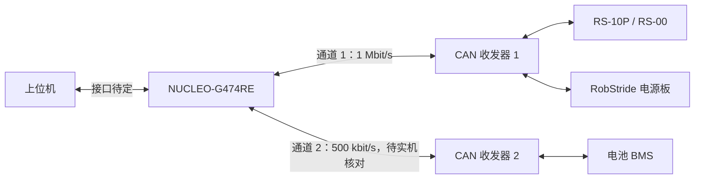

# PICO-Firmware 固件设计

本仓库是 [PICO-Humanoid](https://pico-humanoid.github.io/ "访问项目主页") 负责固件设计部分的子项目，主要涵盖关节电机、电池 BMS 与电源板的 CAN 通信，以及 MCU 程序、上下位机接口和通信联调。

当前采用 **NUCLEO-G474RE** 开发板开展通信验证，围绕“上位机生成目标、主板组织通信、设备执行与反馈”推进，为实验室自主人形机器人平台提供底层通信支持。

相关子项目：[机械设计](https://github.com/pico-humanoid/pico-mechanism) · [电气设计](https://github.com/pico-humanoid/pico-electronics)

## 当前进展

| 工作内容 | 当前状态 | 说明 |
| --- | --- | --- |
| 设备协议与通信方案 | 已梳理 | 包括 RS-10P / RS-00、电池 BMS、电源板，以及上下位机建议分工和 CAN 分路条件 |
| 开发环境与验证工程 | 已准备 | 编译、烧录、串口日志工具及内部回环、外部收发两种验证固件已准备并编译通过 |
| 内部回环 | 已通过，完整日志已归档 | 最新 [17:11:37 日志](logs/2026-10-27/board_20261027_171137.csv)含模式、列头及完整记录，提交发送、发送完成、接收各 100 条，序号无缺失和重复，RESULT=PASS |
| 外部 CAN 单次触发返回 100 帧 | 功能已验证，自动 RESULT 判据需区分 | 2026-10-27 电脑发送 1 条 `0x321`，板端返回 100 条 `0x123`，两端数据一致；原始 RESULT 为 FAIL，原因见[源码行为与实测记录](docs/validation/2026-10-27.md) |
| 单设备只读查询 | 待验证 | 分别验证关节、电池 BMS、电源板的请求、回复与解析 |
| 多节点与上下位机联调 | 待开展 | 核对位速率、设备 ID、状态有效性、总线负载与时延 |

> 本仓库已收录[验证工程与烧录文件](firmware/PICO_CAN/IMPORT.md)、[日志采集脚本](firmware/PICO_CAN/scripts/capture.ps1)、[2026-10-27 原始日志](logs/2026-10-27/)与[结果分析](docs/validation/2026-10-27.md)。源码、固件和历史日志按上传版本归档，已确定的接线、实测结果与待实现设计分别说明。

## 工程、烧录文件与日志工具

- [下载完整原始工程 ZIP](archives/PICO_CAN_20261027.zip)：保留上传包的全部 310 个文件，包括源码、编译产物、缓存与历史记录。
- [浏览已展开的验证工程](firmware/PICO_CAN/) · [导入说明与文件校验](firmware/PICO_CAN/IMPORT.md) · [主要测试源码](firmware/PICO_CAN/App/can_bringup.c)

| 模式 | ELF | HEX | BIN | 烧录入口 |
| --- | --- | --- | --- | --- |
| 内部回环 Loopback | [PICO_CAN.elf](firmware/PICO_CAN/build/Loopback/PICO_CAN.elf) | [PICO_CAN.hex](firmware/PICO_CAN/build/Loopback/PICO_CAN.hex) | [PICO_CAN.bin](firmware/PICO_CAN/build/Loopback/PICO_CAN.bin) | [03_Flash_Loopback.cmd](firmware/PICO_CAN/03_Flash_Loopback.cmd) |
| 外部 CAN External | [PICO_CAN.elf](firmware/PICO_CAN/build/External/PICO_CAN.elf) | [PICO_CAN.hex](firmware/PICO_CAN/build/External/PICO_CAN.hex) | [PICO_CAN.bin](firmware/PICO_CAN/build/External/PICO_CAN.bin) | [05_Flash_External.cmd](firmware/PICO_CAN/05_Flash_External.cmd) |

- 日志采集：[04_Capture_Log.cmd](firmware/PICO_CAN/04_Capture_Log.cmd) 调用 [capture.ps1](firmware/PICO_CAN/scripts/capture.ps1)；[check_log.py](firmware/PICO_CAN/scripts/check_log.py) 保留原版检查规则。
- 全部历史板端记录：[工程内 20 份 CSV](firmware/PICO_CAN/logs/)及[历史日志索引](docs/validation/log-archive.md)。本轮最新内部回环、外部板端日志和 USBCAN 导出见 [logs/2026-10-27](logs/2026-10-27/)。

已展开工程保留完整源码、HAL/CMSIS 依赖、配置和六个烧录文件；编译缓存及中间文件保留在原始 ZIP 中。原脚本依赖 Windows 上已安装的 STM32 工具，换电脑使用时按[导入说明](firmware/PICO_CAN/IMPORT.md)核对工具路径。此次没有修改固件行为或原始日志。

## 硬件与开发环境

| 项目 | 当前配置或用途 |
| --- | --- |
| MCU 开发板 | NUCLEO-G474RE，主控为 STM32G474RE |
| CAN 控制器 | 使用芯片内部 FDCAN 外设，当前设备按经典 CAN 通信 |
| CAN 收发器 | 当前单路外部实验使用 SN65HVD230 模块；每条独立 CAN 总线各配一块收发器 |
| 调试接口 | 板载 ST-LINK，用于烧录、调试及虚拟串口日志 |
| CAN 调试工具 | [Waveshare USB-CAN-A 适配器及配套软件](https://www.waveshare.net/wiki/USB-CAN-A)，用于发帧、接收与抓包 |
| 关节模组 | RobStride RS-10P、RS-00，按各型号协议与参数范围分别配置 |
| 电源设备 | RobStride 电源板、带 CAN 接口的电池 BMS，方案见电气设计仓库 |
| 开发工具 | STM32CubeMX、VS Code STM32 扩展、编译与烧录工具 |

- 当前验证平台由早期建议的 STM32F407 方案调整为 NUCLEO-G474RE。G474 提供三路 FDCAN 控制器，主要考虑后续分路余量；具体可用引脚与板上连接仍需按实际硬件核对。
- FDCAN 支持 CAN FD，但接入现有设备时仍需匹配其经典 CAN 协议，不能据此外推实际通信速率。
- [RobStride 电机控制库](https://github.com/RobStride/RobStrideSPC)作为官方参考；使用其中的 STM32 HAL 实现时，需要核对与 G474 FDCAN 外设的适配情况。
- 当前开发流程为 CubeMX 配置外设、生成工程、编译、ST-LINK 烧录，再通过虚拟串口与 USB-CAN 记录验证结果。已上传原工程的[构建与烧录脚本](firmware/PICO_CAN/scripts/)，使用方法见[工程导入说明](firmware/PICO_CAN/IMPORT.md)。

### 已确定的三路 CAN 引脚

| 通道 | 发送 TX / 排针位置 | 接收 RX / 排针位置 | 复用功能 | 当前安排 |
| --- | --- | --- | --- | --- |
| FDCAN1 | PA12 / CN10-12 | PA11 / CN10-14 | AF9 | 沿用当前单路验证接线，规划接关节与电源板 |
| FDCAN2 | PB13 / CN10-30 | PB12 / CN10-16 | AF9 | 规划接电池 BMS，待配置和实测 |
| FDCAN3 | PA15 / CN7-17 | PA8 / CN10-23 | AF11 | 预留整机扩展，待配置和实测 |

以上为 NUCLEO-G474RE 已选定的接线组合，排针编号不是芯片管脚编号。每条独立总线各配一颗收发器；本次实测覆盖 FDCAN1，不能据此认定另外两路已验证。

PA15 用于 FDCAN3 后，调试采用 SWD，保留 PA13、PA14。PA11、PA12 同时也是芯片原生 USB 的数据引脚，当前 CAN1 接法与原生 USB 存在复用冲突；板载 ST-LINK 的 USB 烧录、调试与虚拟串口不受此冲突影响。

### 已约定的提示器件引脚

| 器件 | 引脚 / 排针位置 | 用途 |
| --- | --- | --- |
| 有源蜂鸣器 | PB0 / CN7-34 | 经驱动电路进行异常报警 |
| LED1 | PB1 / CN10-24 | 运行指示 |
| LED2 | PB2 / CN10-22 | 通信与故障指示 |

这三项为后续主板接线约定，固件适配与实物验证待完成。当前 NUCLEO 验证程序仍使用板载 PA5 / LD2 表示测试状态；外接 LED 各串联限流电阻，蜂鸣器通过三极管或 MOS 管驱动。

### 当前单路实验接线

以下对应 NUCLEO-G474RE 与 **3.3 V SN65HVD230 模块**的外部收发实验。

| 开发板引脚 | 排针位置 | 收发器模块 |
| --- | --- | --- |
| PA12，FDCAN1_TX | CN10-12 | TXD / D |
| PA11，FDCAN1_RX | CN10-14 | RXD / R |
| 3V3 | 按板上标识 | VCC |
| GND | 按板上标识 | GND |

收发器的 CANH、CANL 分别连接 USB-CAN 对应端子，信号地连接按适配器说明处理。总线主干两端各设置一个 **120 Ω** 终端电阻，模块已有的终端电阻也计入；接入设备时核对是否重复端接。

以上为当前验证接线。后续增加独立通道或采用主板时，需重新核对引脚复用、收发器供电与主板连接，不能直接套用这组排针位置。

### 串口、CAN 速率与测试报文

| 通路 | 当前约定 | 用途 |
| --- | --- | --- |
| 开发板日志串口 | LPUART1，PA2 为 TX、PA3 为 RX，经 ST-LINK 虚拟串口；115200 bit/s、8N1 | 输出事件与 RESULT 汇总，供采集脚本保存 CSV |
| USB-CAN-A 电脑端串口 | 默认 2000000 bit/s，使用适配器自己的 COM 口 | USBCAN 软件与适配器通信 |
| FDCAN1 外部测试 | 1 Mbit/s、正常模式、经典 CAN、标准数据帧、DLC=8 | G474 与 USB-CAN-A 进行基础收发 |
| 电脑发往开发板 | 单次触发：ID `0x321`；数据 `00 88 77 66 55 44 33 22` | 发送 1 条有效触发帧，启动板端的 100 帧返回 |
| 开发板发往电脑 | 固定 ID `0x123`；数据 `NN 22 33 44 55 66 77 88` | 收到首条有效测试帧后，按测试程序发送 100 帧 |

日志串口、适配器串口与 CAN 总线是不同通路，速率分别设置。COM5（ST-LINK）和 COM6（USB-CAN-A）是此前电脑上的编号示例，实际使用时以设备管理器为准。当前外部程序的运行行为是“一条有效触发帧启动 100 条返回”，但共用的自动 PASS 判据仍要求板端接收 100 个唯一序号；功能结果与原始 RESULT 分别记录。

串口消息格式为 `t_ms,event,format,id,dlc,data`，其中 `t_ms` 是开发板启动后的毫秒数；`TX_SUBMIT` 表示提交发送，`TX_DONE` 表示发送完成，`RX` 表示接收。末尾 `# RESULT=...` 汇总计数与测试判定。详细的[配置、报文说明与日志采集步骤](docs/can-bringup.md)已单独整理。

## CAN 通信方案

### 接入对象与协议

| 对象 | 通信方式 | 主要工作 | 当前需要核对的内容 |
| --- | --- | --- | --- |
| RS-10P / RS-00 关节模组 | 经典 CAN，29 位扩展帧；当前方案为 1 Mbit/s | 读取设备信息、角度与状态，后续接入模式设置和控制指令 | 设备 ID、固件与协议版本、各型号缩放范围及运行限制 |
| 电池 BMS | 经典 CAN，标准远程帧查询、数据帧回复；协议文档默认为 500 kbit/s | 读取电池状态，按协议检查字段、单位与校验 | 实机位速率、是否支持并能配置为 1 Mbit/s |
| RobStride 电源板 | 按电源板协议查询或自动上报；起步方案按 1 Mbit/s 联调 | 读取电压、温度、故障及支路信息 | 实机 ID、上报周期，以及 Type03 电流字段的位定义 |

关节、电池与电源板分别使用对应解析逻辑，不能共用一套 ID、字节序或物理量换算规则。电源资料见[供电方案](https://github.com/pico-humanoid/pico-electronics/blob/main/power/供电方案.md)与[电池方案](https://github.com/pico-humanoid/pico-electronics/blob/main/power/电池方案.md)。

### 分路与布线

- **起步联调：** 两台关节与电源板先按一路 1 Mbit/s CAN 规划，先完成基础收发与各设备只读查询。
- **接入电池：** 若 BMS 保持 500 kbit/s、关节侧保持 1 Mbit/s，则使用两条独立 CAN 总线，各配控制器通道和收发器。若确认 BMS 支持并能配置为 1 Mbit/s，再评估共线。
- **整机扩展：** 根据关节数量、报文频率、负载和时延决定最终路数。机械组当前为 14 自由度方案；关节数量与独立 CAN 总线路数分别统计。
- **电气配合：** 现用电源板的供电端口不直接集成电机 CAN，需另行设计电机 CAN 集线接口。供电路径与通信布线分别规划，并与电气组确认连接器和引脚定义。

下面为计划中的双路逻辑连接，实际布线与通道配置以联调结果为准。

### 第一条关节查询示例

先采用只读查询检查通信与解析，示例为读取机械角度 `mechPos`：

| 参数 | 示例值 |
| --- | --- |
| 电机 ID / 主机 ID | `0x01` / `0xFD` |
| 参数索引 | `0x7019` |
| 帧格式 / 扩展 ID | 扩展数据帧 / `0x1100FD01` |
| DLC / 数据 | 8 / `19 70 00 00 00 00 00 00` |

该示例来自当前协议梳理，尚未作为实机查询通过的结果。接入时先确认目标设备协议版本，收到回复后核对来源、状态、参数索引与数据长度，再按协议还原角度及单位。

## 固件职责与接口设计

### 上下位机分工

| 层级 | 建议职责 |
| --- | --- |
| 上位机 | 状态估计、MPC / 控制策略、关节目标生成、显示与实验记录 |
| G474 主板 | 设备协议编解码、CAN 收发与调度、反馈汇总、时间和有效性检查、超时与故障处理 |
| 关节模组 | 内部控制、目标执行与设备状态反馈 |

上下位机物理接口与数据格式尚待确定。下发信息计划包含模式、关节目标、序号和有效期；上传信息计划包含设备状态、时间、有效标志和故障。控制周期、运行限值、指令过期后的动作需与控制侧共同约定。

### 收发与状态管理

1. **初始化：** 配置时钟、引脚、经典 CAN 位时序、过滤器、接收 FIFO 与中断，启动后检查返回值和协议状态。
2. **发送：** 将物理量按设备协议编码，进入软件发送队列，再提交硬件；分别记录请求入队、硬件发送完成和设备回复，避免混淆各阶段的成功状态。
3. **接收：** 中断及时从硬件 FIFO 取帧并记录接收时刻，交给有界软件队列，后续任务再完成协议分发与解析。
4. **更新：** 校验帧格式、完整 ID、DLC、字段与协议校验后，更新对应设备状态、时间和有效标志。
5. **诊断：** 分别统计 FIFO 溢出、软件队列丢帧、解析错误、回复超时及总线错误，并检查目标是否过期。

以上为后续固件实现与联调的设计依据。接收时间不等同于设备采样时间；总线负载预算也需与实测排队、重传和端到端时延分别记录。

## 验证流程与结果记录

按“内部回环 → 外部双向收发 → 单设备只读 → 多节点联调 → 上下位机联调”推进。每次测试记录日期、硬件与固件版本、接线、通道、位速率、帧格式、设备 ID、发送周期和帧数；日志保留方向、ID、DLC、原始数据、时间与解析结果。

2026-10-27 的最新内部回环日志、外部板端日志与 USBCAN 导出已归档，详见[源码行为、实测记录与逐帧核对](docs/validation/2026-10-27.md)。内部回环采用 17:11:37 的完整日志，各类事件均已独立核对 100 条并通过；外部“电脑发 1 条、板端返回 100 条”已由两端记录核对，原始自动 RESULT 为 FAIL 的原因单独说明，截图位置继续保留。

以下为各阶段的结果图片预留位置。后续上传图片时，可使用各处注释中的文件名并取消对应图片语句的注释；新增测试轮次时保留旧记录，追加日期、条件与结果。

### 1. 内部回环

**状态：** 2026-10-27 最新完整日志已通过核对，作为当前内部回环结果。

**验证内容：** 检查发送、过滤、Rx FIFO 与日志记录。内部回环不经过外部收发器和总线，结果单独记录。

**本次结果：** 最新 [board_20261027_171137.csv](logs/2026-10-27/board_20261027_171137.csv)明确记录 `mode=INTERNAL_LOOPBACK`，含列头、300 条逐帧事件和 PASS 汇总。`TX_SUBMIT`、`TX_DONE`、`RX` 各有 100 条，序号均完整覆盖 `00`—`63`，ID、长度与载荷一致，无缺失、重复或所列错误。

> **结果图片预留：内部回环日志**
>
> 放置包含发送 / 接收统计、错误计数与最终判定的串口截图。

<!--  -->

### 2. 外部 CAN 双向收发

**状态：** 2026-10-27 单次触发返回 100 帧的功能已验证；原始 `RESULT=FAIL` 保留，自动判据与功能目标的区别见下文。

**验证内容：** G474、SN65HVD230 与 USB-CAN 按 1 Mbit/s、经典 CAN 标准数据帧进行外部通信。本次电脑先发送 1 条 8 字节触发帧，板端收到后按约 100 ms 间隔返回 100 帧，返回数据第一字节递增：

| 方向 | 帧 ID | 首帧数据 | 本轮数量 / 末帧数据 |
| --- | --- | --- | --- |
| USB-CAN → G474 | `0x321` | `00 88 77 66 55 44 33 22` | 1 条触发帧 |
| G474 → USB-CAN | `0x123` | `00 22 33 44 55 66 77 88` | 100 条；末帧 `63 22 33 44 55 66 77 88` |

已核对上传的[实际源码](firmware/PICO_CAN/App/can_bringup.c)：首条有效接收启动发送序列，最多发送 100 条返回；但末尾共用的 PASS 条件还要求 `rx_unique=100`。因此，本次单触发功能的核对结论与固件打印的自动 RESULT 分开列出，不改写原始日志。

| 本次实测项目 | 记录结果 |
| --- | --- |
| [板端日志](logs/2026-10-27/board_20261027_164330.csv) | 提交发送 100、发送完成 100、唯一接收 1、预期接收缺失 99，结果 FAIL |
| [USBCAN 导出](logs/2026-10-27/2026.10.27.txt) | 发送 1 条 `0x321`，接收 100 条 `0x123`，返回序号完整覆盖 `00`—`63` |
| 两端逐帧核对 | 电脑发送的 1 帧与板端 RX 一致；板端发送完成的 100 帧与电脑收到的 100 帧按 ID、DLC、载荷和顺序全部一致 |

本轮已验证“一条触发、100 条返回”，返回序号和载荷完整。自动 FAIL 来自程序仍检查板端是否接收了 100 个唯一序号；`rx_missing=99` 反映这一自动预期，不能直接解释为总线丢失了 99 条已经发送的帧。若后续进行每方向 100 帧测试，需另按递增发送配置开展；若调整单触发模式的自动判据，应产生并归档新的固件版本，详见[源码核对与后续安排](docs/validation/2026-10-27.md)。

> **结果图片预留 A：板端串口日志**
>
> 展示本轮接收 1、发送完成 100 及原始 RESULT，结合源码说明判据；后续新版本结果另行追加。

<!--  -->

> **结果图片预留 B：USB-CAN 接收记录**
>
> 展示返回帧 ID、序号、数据与接收数量，和板端日志相互核对。

<!--  -->

### 3. 单关节只读查询

**状态：** 待验证。

**验证内容：** 先核对设备 ID 与协议版本，再读取机械角度和设备状态；核对请求与回复匹配、字段换算、单位及超时。RS-10P 与 RS-00 分别记录型号、参数和结果。

> **结果图片预留：关节查询与解析**
>
> 分别补充两种关节的原始请求 / 回复和解析值，标明设备型号与 ID。

<!--  -->
<!--  -->

### 4. 电池 BMS 只读查询

**状态：** 待验证，先确认实机位速率。

**验证内容：** 按电气组提供的 BMS 协议发送标准远程帧查询，匹配数据帧回复，检查字段、校验与物理量；记录实机位速率及配置方式。

> **结果图片预留：BMS 原始报文与状态解析**
>
> 展示查询、回复、校验结果和对应状态值，并注明实际通信配置。

<!--  -->

### 5. 电源板只读查询与上报

**状态：** 待验证，Type03 电流字段待确认。

**验证内容：** 核对电源板 ID，先查询已明确的电压、温度与故障字段，再验证自动上报周期。Type03 电流字段在定义核对或实际帧验证完成后补充解析。

> **结果图片预留：电源板查询与上报**
>
> 展示查询回复、状态解析与连续上报的时间间隔；待确认字段单独标注。

<!--  -->
<!--  -->

### 6. 多节点与分路联调

**状态：** 待开展。

**验证内容：** 在单设备验证通过后，接入两关节与电源板，再按实机位速率接入 BMS。检查 ID 与协议分发、各节点状态更新、负载、丢帧和超时；后续逐步扩展关节数量。

> **结果图片预留：多节点拓扑与通信统计**
>
> 放置实物连接图、各节点状态和按通道统计的负载 / 错误 / 时延记录，标明节点数与报文频率。

<!--  -->
<!--  -->

### 7. 上下位机接口联调

**状态：** 待接口方案确定后开展。

**验证内容：** 先跑通一条只读请求与一组状态反馈，再接入目标下发；核对序号、时间、状态有效性和指令过期处理，最后配合控制侧验证周期与限值。

> **结果图片预留：上下位机请求与状态反馈**
>
> 展示同一次请求在上位机、主板与设备侧的对应记录，以及实际测得的端到端时延。

<!--  -->

### 8. 异常与恢复验证

**状态：** 待基础联调完成后开展。

**验证内容：** 按约定测试设备不回复、反馈过期、队列积压与总线错误等情况，核对错误分类、状态失效、指令处理及恢复条件，保留触发条件和处理前后的记录。

> **结果图片预留：异常检测与恢复记录**
>
> 展示故障触发、错误计数、状态变化、处置和恢复过程。

<!--  -->

## 待确认事项与后续工作

- [x] 归档 2026-10-27 最新内部回环、外部板端日志及 USBCAN 导出。
- [x] 核对最新内部回环从模式、列头、全部 300 条事件到 RESULT 的完整记录。
- [ ] 补充内部回环与外部单触发实验的结果截图。
- [x] 核对单次触发返回 100 帧的两端原始记录，并说明自动 FAIL 的共用判据。
- [x] 导入实际工程、两种模式的六个烧录文件、烧录与采集脚本及全部历史日志，核对文件校验值并说明外部测试自动判据。
- [ ] 如开展每方向 100 帧完整性测试，另存该测试的两端日志、固件版本与截图。
- [ ] 完成 RS-10P、RS-00、电池 BMS、电源板的单设备只读查询。
- [ ] 确认 BMS 实机位速率，以及是否支持配置为 1 Mbit/s。
- [ ] 确认电源板 Type03 电流字段定义，并核对实机 ID 与上报周期。
- [x] 选定三路 CAN 与蜂鸣器、两个 LED 的主板接线引脚，记录已选定与已实测的区别。
- [ ] 与机械、电气组确认最终关节清单、CAN 集线方式和独立总线路数，并验证第二、三路 CAN 及提示器件电路。
- [ ] 完善协议编解码、收发队列、时间与状态有效性管理，并进行多节点负载和时延测试。
- [ ] 与控制侧确定上下位机接口、控制周期、指令有效期、运行限值及异常动作。
- [ ] 后续补充设备协议实现、新版本固件与对应测试记录；本次上传的验证工程和产物保留为原始版本。

## 相关资料

- [完整原始工程 ZIP](archives/PICO_CAN_20261027.zip) · [源码、固件与工具入口](firmware/PICO_CAN/IMPORT.md) · [历史日志索引](docs/validation/log-archive.md)
- [通信配置、串口消息与日志采集](docs/can-bringup.md)
- [2026-10-27 实测记录与结果分析](docs/validation/2026-10-27.md) · [本轮原始日志](logs/2026-10-27/)
- [PICO-Humanoid 项目主页](https://pico-humanoid.github.io/)
- [机械设计仓库](https://github.com/pico-humanoid/pico-mechanism)：关节型号、结构与自由度规划。
- [电气设计仓库](https://github.com/pico-humanoid/pico-electronics)：主板、电源与设备资料。
- [供电方案](https://github.com/pico-humanoid/pico-electronics/blob/main/power/供电方案.md) · [电池方案](https://github.com/pico-humanoid/pico-electronics/blob/main/power/电池方案.md)
- [RobStride 电机控制库](https://github.com/RobStride/RobStrideSPC) · [RobStride 产品资料](https://github.com/RobStride/Product_Information)
- [STM32G474RE 数据手册](https://www.st.com/resource/en/datasheet/stm32g474re.pdf)
- [NUCLEO-G474RE 板卡手册](https://www.st.com/resource/en/user_manual/um2505-stm32g4-nucleo64-boards-mb1367-stmicroelectronics.pdf)
- [SN65HVD230 数据手册](https://www.ti.com/lit/ds/symlink/sn65hvd230.pdf)
- [Waveshare USB-CAN-A 官方使用说明](https://www.waveshare.net/wiki/USB-CAN-A)：驱动与配置工具下载、硬件接线、CAN 参数设置及收发测试。
