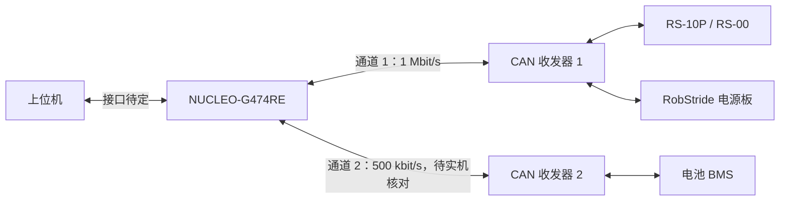

# 通信方案与固件职责

更新日期：2026-10-27。设备协议已有资料依据，具体实现与实机查询仍按测试结果记录。

## CAN 通信方案

### 接入对象与协议

| 对象 | 通信方式 | 主要工作 | 当前需要核对的内容 |
| --- | --- | --- | --- |
| RS-10P / RS-00 关节模组 | 经典 CAN，29 位扩展帧；当前方案为 1 Mbit/s | 读取设备信息、角度与状态，后续接入模式设置和控制指令 | 固件侧读取或核对设备 ID、版本和各型号协议参数；装配后的运行范围与机械、控制侧共同确定 |
| 电池 BMS | 经典 CAN，标准远程帧查询、数据帧回复；协议文档默认为 500 kbit/s | 读取电池状态，按协议检查字段、单位与校验 | 固件侧查阅现有协议、读取或实测位速率；配置能力不明确时向供应方核实 |
| RobStride 电源板 | 按电源板协议查询或自动上报；起步方案按 1 Mbit/s 联调 | 读取电压、温度、故障及支路信息 | 固件侧查询 ID 与上报周期，核对 Type03 文档与样例；仍有歧义再向供应方确认 |

关节、电池与电源板分别使用对应解析逻辑，不能共用一套 ID、字节序或物理量换算规则。电源资料见[供电方案](https://github.com/pico-humanoid/pico-electronics/blob/main/power/供电方案.md)与[电池方案](https://github.com/pico-humanoid/pico-electronics/blob/main/power/电池方案.md)。

### 分路与布线

- **起步联调：** 两台关节与电源板先按一路 1 Mbit/s CAN 规划，先完成基础收发与各设备只读查询。
- **接入电池：** 若 BMS 保持 500 kbit/s、关节侧保持 1 Mbit/s，则使用两条独立 CAN 总线，各配控制器通道和收发器。若确认 BMS 支持并能配置为 1 Mbit/s，再评估共线。
- **整机扩展：** 根据关节数量、报文频率、负载和时延决定最终路数。机械组当前为 14 自由度方案；关节数量与独立 CAN 总线路数分别统计。
- **电气配合：** 现用电源板的供电端口不直接集成电机 CAN，需另行设计电机 CAN 集线接口。供电路径与通信布线分别规划，并与电气组确认连接器和引脚定义。

下面为计划中的双路逻辑连接，实际布线与通道配置以联调结果为准。

### 第一条关节查询示例

先采用只读查询检查通信与解析，示例为读取机械角度 `mechPos`：

| 参数 | 示例值 |
| --- | --- |
| 电机 ID / 主机 ID | `0x01` / `0xFD` |
| 参数索引 | `0x7019` |
| 帧格式 / 扩展 ID | 扩展数据帧 / `0x1100FD01` |
| DLC / 数据 | 8 / `19 70 00 00 00 00 00 00` |

该示例来自当前协议梳理，尚未作为实机查询通过的结果。接入时先确认目标设备协议版本，收到回复后核对来源、状态、参数索引与数据长度，再按协议还原角度及单位。

## 固件职责与接口设计

### 上下位机分工

| 层级 | 建议职责 |
| --- | --- |
| 上位机 | 状态估计、MPC / 控制策略、关节目标生成、显示与实验记录 |
| G474 主板 | 设备协议编解码、CAN 收发与调度、反馈汇总、时间和有效性检查、超时与故障处理 |
| 关节模组 | 内部控制、目标执行与设备状态反馈 |

上下位机物理接口与数据格式由固件侧先起草，再与控制侧核对需求并共同确定。下发信息计划包含模式、关节目标、序号和有效期；上传信息计划包含设备状态、时间、有效标志和故障。控制周期、运行限值、指令过期后的动作需与控制侧共同约定。

### 收发与状态管理

1. **初始化：** 配置时钟、引脚、经典 CAN 位时序、过滤器、接收 FIFO 与中断，启动后检查返回值和协议状态。
2. **发送：** 将物理量按设备协议编码，进入软件发送队列，再提交硬件；分别记录请求入队、硬件发送完成和设备回复，避免混淆各阶段的成功状态。
3. **接收：** 中断及时从硬件 FIFO 取帧并记录接收时刻，交给有界软件队列，后续任务再完成协议分发与解析。
4. **更新：** 校验帧格式、完整 ID、DLC、字段与协议校验后，更新对应设备状态、时间和有效标志。
5. **诊断：** 分别统计 FIFO 溢出、软件队列丢帧、解析错误、回复超时及总线错误，并检查目标是否过期。

以上为后续固件实现与联调的设计依据。接收时间不等同于设备采样时间；总线负载预算也需与实测排队、重传和端到端时延分别记录。

## 资料使用与验证分工

关节型号和结构参考[机械仓库](https://github.com/pico-humanoid/pico-mechanism)，BMS 协议与电源板手册参考[电气仓库](https://github.com/pico-humanoid/pico-electronics)。固件侧自行完成协议阅读、字段解释、编解码、设备 ID 配置与台架查询；已有资料直接引用版本。确需协作确认的装配、接线与控制约束见[协作清单](../collaboration/README.md)。

[硬件接线](../hardware/README.md) · [CAN 验证操作](../can-bringup.md) · [开发计划](../firmware-development.md) · [返回仓库首页](../../README.md)
